# Windows Server 2022 Active Directory & Group Policy Lab

A hands-on sysadmin lab built on **VMware Workstation Pro**, **Windows Server 2022** and **Windows 11 Pro**. It covers deploying AD DS and DNS, organizing users and groups, joining a client to the domain, fixing a real DNS problem, and targeting a Group Policy with security filtering.

**At a glance**

| | |
|---|---|
| **Outcome** | Working `lab.example.com` domain with a domain-joined Windows 11 client and a security-filtered GPO |
| **Real problem solved** | Stale and unwanted DNS A records for the DC after changing VM networks ([details](docs/dns-troubleshooting.md)) |
| **Automation** | Whole lab reproducible with the PowerShell scripts in [`scripts/`](scripts/) |
| **Time to rebuild** | ~1 hour using the [step-by-step guide](#reproduce-the-lab) |

## Contents

- [Lab environment](#lab-environment)
- [Network topology](#network-topology)
- [What was built](#what-was-built)
- [Evidence](#evidence)
- [Reproduce the lab](#reproduce-the-lab)
- [Group Policy: security filtering](#group-policy-security-filtering)
- [Verification commands](#verification-commands)
- [Repository layout](#repository-layout)
- [Skills demonstrated](#skills-demonstrated)
- [Next steps](#next-steps)

## Lab environment

| Component | Configuration |
|---|---|
| Hypervisor | VMware Workstation Pro |
| Domain controller | `DC01`, Windows Server 2022 Standard Evaluation (AD DS + DNS) |
| Domain / forest | `lab.example.com` (NetBIOS `LAB`), isolated lab domain |
| DC IP | `192.168.163.10/24` |
| Client | `CLIENT01`, Windows 11 Pro, `192.168.163.20/24` |
| VMware network | VMnet1, host-only, `192.168.163.0/24` |
| Client DNS | `192.168.163.10` (the DC) |
| OUs | `IT`, `HR`, `Finance` |
| Groups | `IT-staff`, `IT-ControlPanel-Restricted` |

> The lab uses a private host-only network. Addresses and names are illustrative, not production recommendations.

## Network topology

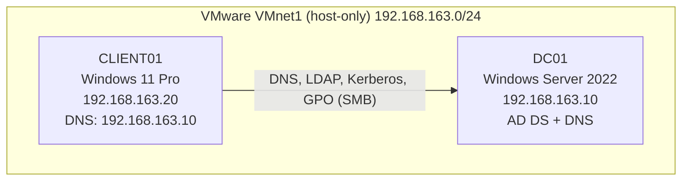

## What was built

1. Installed Windows Server 2022 and promoted `DC01` to the first domain controller of `lab.example.com`.
2. Configured the host-only network, static IPv4 addressing and AD-integrated DNS.
3. Created the IT, HR and Finance OUs, domain users and security groups.
4. Verified the DC host A record, LDAP SRV record and DC discovery.
5. Removed stale DNS A records left over from earlier VM/network configurations.
6. Installed Windows 11 Pro, pointed its DNS at `DC01` and joined it to the domain.
7. Created GPO `IT-Block-ControlPanel`, linked to the IT OU, enabling **Prohibit access to Control Panel and PC settings**.
8. Used the `IT-ControlPanel-Restricted` group and security filtering to target only selected users.
9. Proved the policy with `gpresult` and a domain user session.
10. Built a department file server using **AGDLP**: global and domain local groups, NTFS Modify permissions per folder, the `CompanyData` SMB share with access-based enumeration, and a mapped `Z:` drive on the client ([report](docs/file-server-agdlp.md)).

## Evidence

| Step | Screenshot |
|---|---|
| DC01 in Server Manager (AD DS and DNS roles, domain `lab.example.com`) |  |
| Active Directory domain |  |
| Organizational units |  |
| Users and security groups | 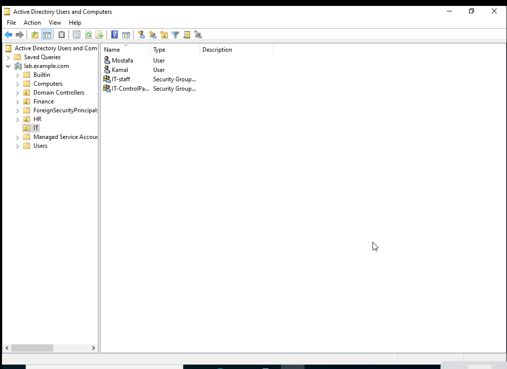 |
| DNS A and SRV records |  |
| Client joined to the domain | 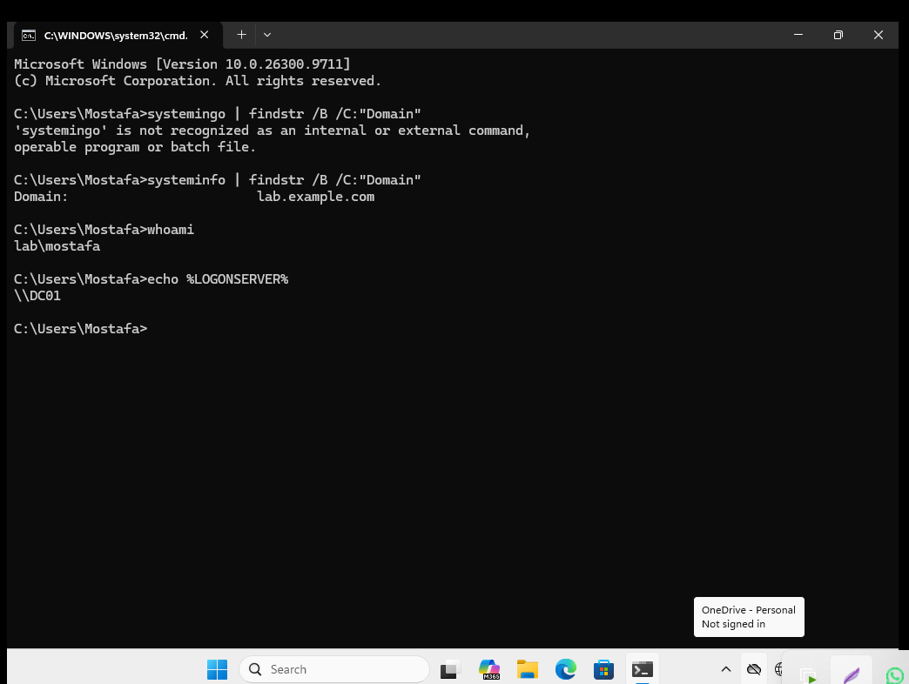 |
| GPO setting configured | 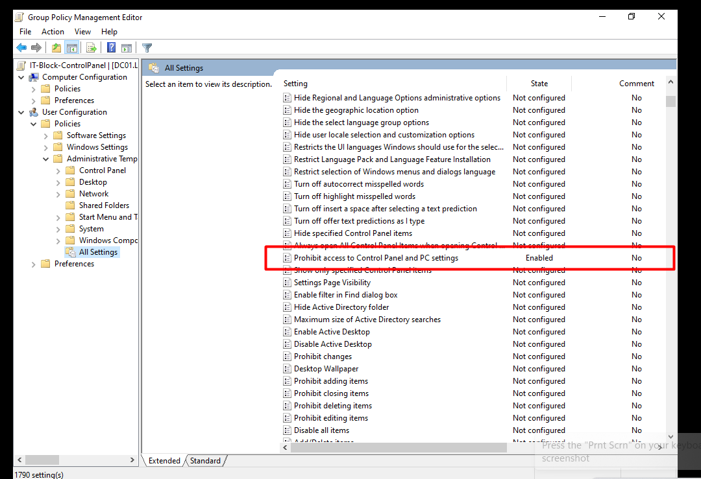 |
| GPO security filtering | 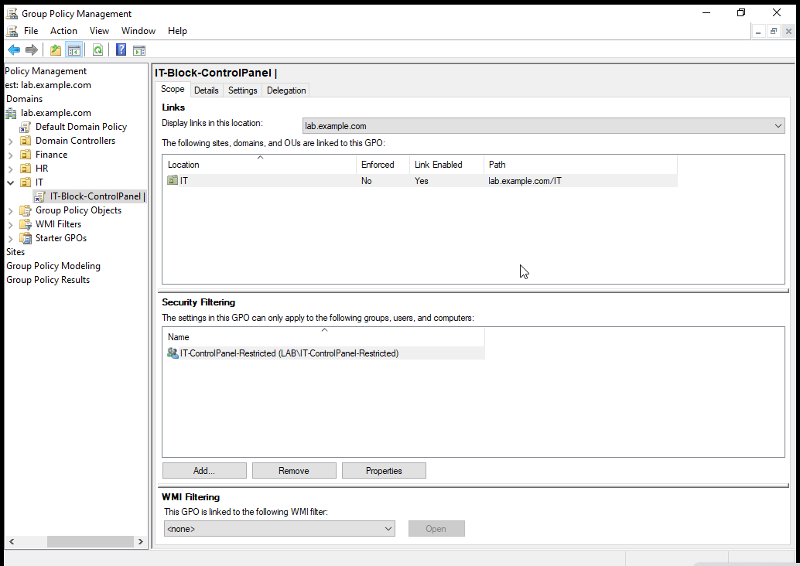 |
| `gpresult` showing the GPO applied | 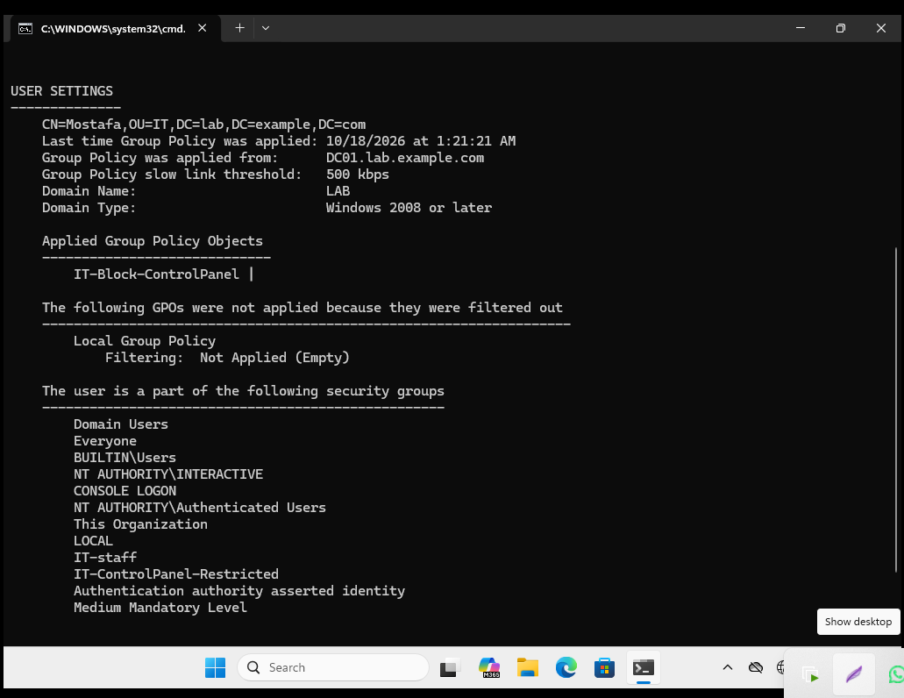 |
| AGDLP groups in the IT OU | 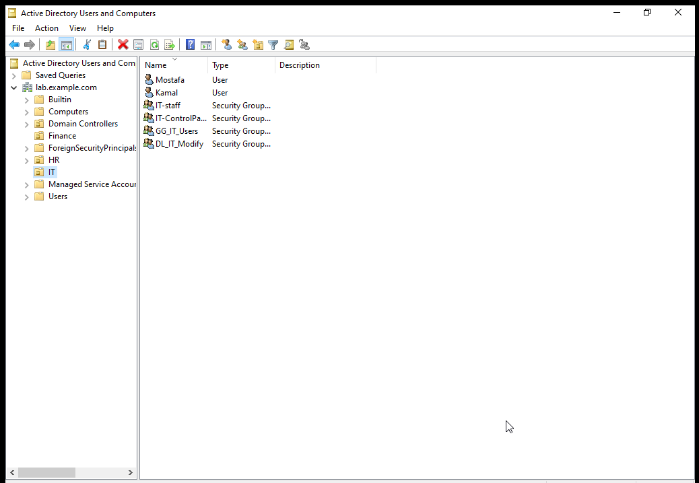 |
| AGDLP membership chain | 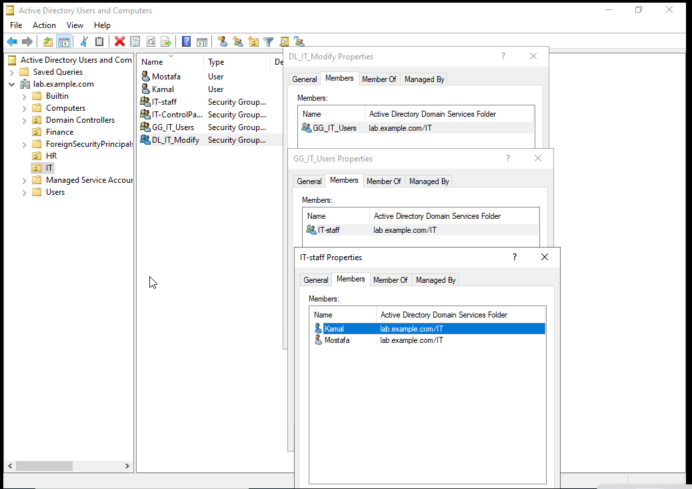 |
| `CompanyData` share | 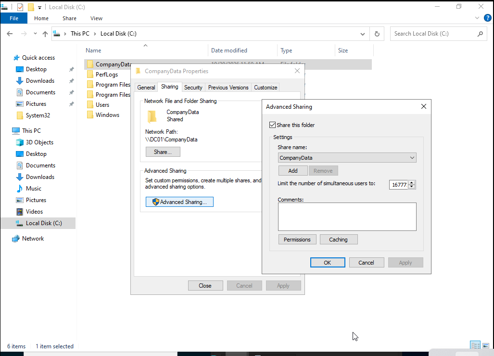 |
| NTFS permissions on the share root | 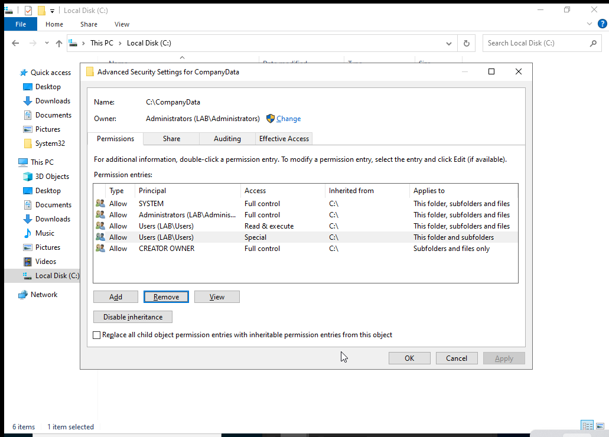 |
| Attempt to open the HR folder | 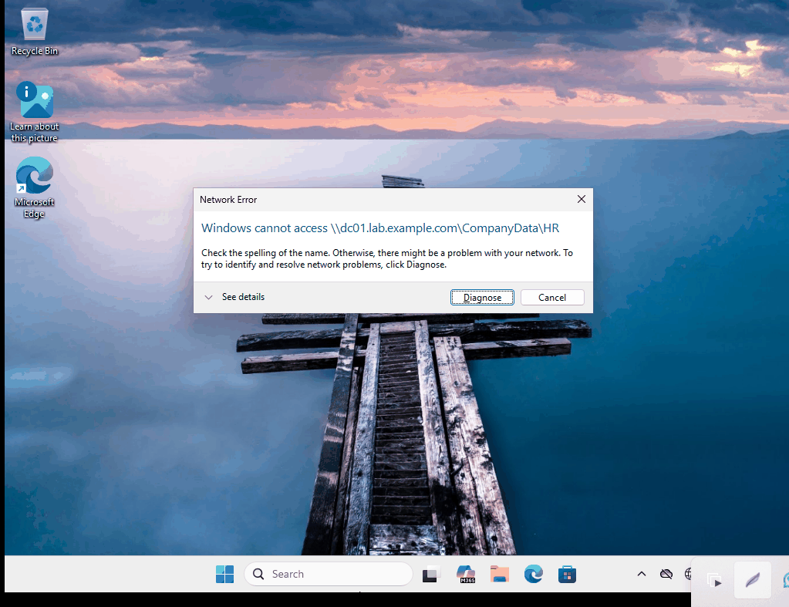 |
| Mapped `Z:` drive | 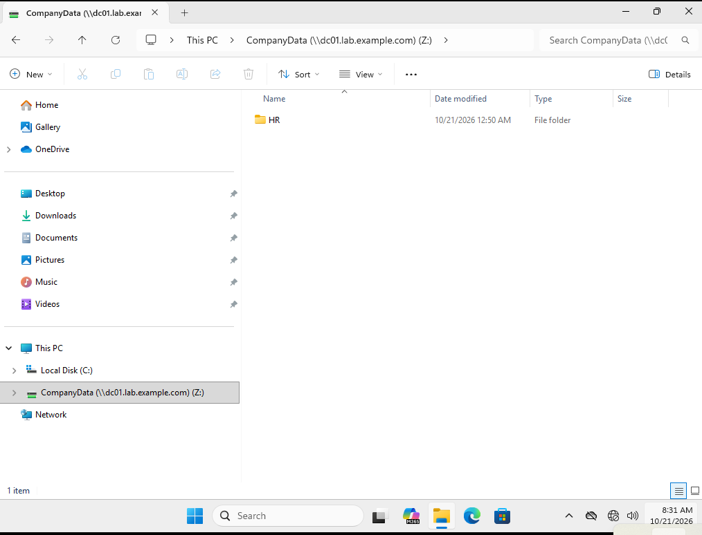 |

## Reproduce the lab

You can follow the docs and click through the GUI, or run the scripts. Run each script in an **elevated PowerShell** session. None of them contain credentials; passwords are requested at runtime.

| Step | Where | Script / doc |
|---|---|---|
| 1. Static IP and DNS | DC01, then CLIENT01 | [`00-Set-StaticIP.ps1`](scripts/00-Set-StaticIP.ps1) · [network doc](docs/network-configuration.md) |
| 2. Install AD DS + DNS, promote DC | DC01 | [`01-Install-ADDS.ps1`](scripts/01-Install-ADDS.ps1) · [DC installation report](docs/domain-controller-installation.md) |
| 3. OUs, groups, users | DC01 | [`02-New-OUsUsersGroups.ps1`](scripts/02-New-OUsUsersGroups.ps1) reads [`data/users.csv`](data/users.csv) |
| 4. GPO + security filtering | DC01 | [`03-New-ControlPanelGPO.ps1`](scripts/03-New-ControlPanelGPO.ps1) · [GPO doc](docs/group-policy-configuration.md) |
| 5. Join the client | CLIENT01 | [`04-Join-Domain.ps1`](scripts/04-Join-Domain.ps1) · [AD setup doc](docs/active-directory-setup.md) |
| 6. File server, AGDLP groups, share | DC01 | [`05-New-FileServer.ps1`](scripts/05-New-FileServer.ps1) · [file server report](docs/file-server-agdlp.md) |
| 7. Health check | Either | [`99-Test-Lab.ps1`](scripts/99-Test-Lab.ps1) |

Example for step 1 on the DC (adjust `-InterfaceAlias` to your adapter name from `Get-NetAdapter`):

```powershell
.\scripts\00-Set-StaticIP.ps1 -InterfaceAlias "Ethernet0" -IPAddress 192.168.163.10 -DnsServer 192.168.163.10
```

## Group Policy: security filtering

**Goal:** restrict Control Panel only for members of `IT-ControlPanel-Restricted`, without affecting other IT OU users.

| Setting | Value |
|---|---|
| GPO link | IT OU |
| User setting | Prohibit access to Control Panel and PC settings = **Enabled** |
| Security filtering | `IT-ControlPanel-Restricted`: Read + Apply group policy |
| Authenticated Users | **Read only**, no Apply (needed so user GPOs can still be read) |

Group membership changes take effect after the user signs out and back in. `gpresult /r /scope user` shows which GPOs were applied or filtered out.

## Verification commands

```powershell
ipconfig /all
nslookup dc01.lab.example.com 192.168.163.10
nslookup -type=SRV _ldap._tcp.dc._msdcs.lab.example.com 192.168.163.10
nltest /dsgetdc:lab.example.com /force
whoami
gpupdate /force
gpresult /r /scope user
dcdiag /test:dns /v        # on DC01
```

Or run everything at once: `.\scripts\99-Test-Lab.ps1`

## Repository layout

```text
.
├── README.md
├── LICENSE
├── data/
│   └── users.csv                  # sample users/groups consumed by script 02
├── docs/
│   ├── network-configuration.md
│   ├── domain-controller-installation.md
│   ├── file-server-agdlp.md
│   ├── active-directory-setup.md
│   ├── dns-troubleshooting.md
│   ├── group-policy-configuration.md
│   ├── lessons-learned.md
│   └── next-steps.md
├── scripts/                       # PowerShell to rebuild the lab
└── screenshots/                   # evidence used in this README
```

## Skills demonstrated

Windows Server 2022 · Active Directory DS · DNS · Windows 11 domain join · Group Policy and security filtering · Security groups · AGDLP, NTFS and SMB share permissions · Access-based enumeration · VMware networking · PowerShell automation · Troubleshooting

## Next steps

Ideas to extend the lab (details in [`docs/next-steps.md`](docs/next-steps.md)): a second DC, DHCP, file shares with NTFS/share permissions, LAPS, password and lockout policy, Windows Firewall GPO, and a backup and restore test.

## Disclaimer

This is a learning lab, not a production deployment. No VM images, ISOs, credentials or license keys are included.

Released under the [MIT License](LICENSE).
