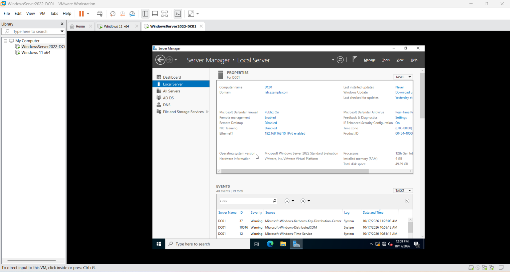
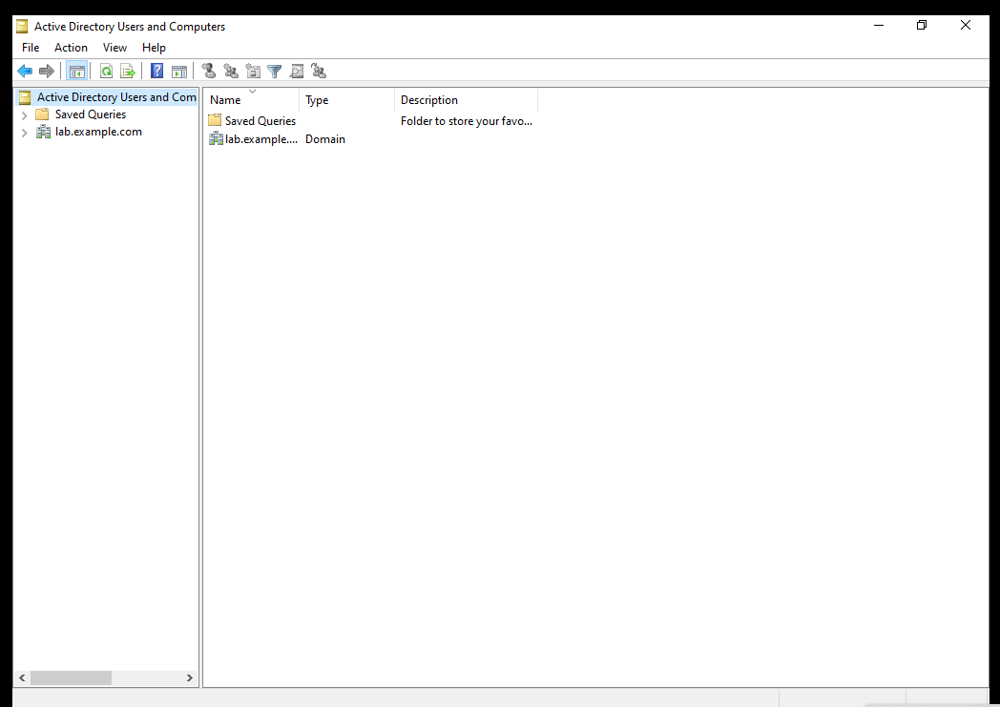
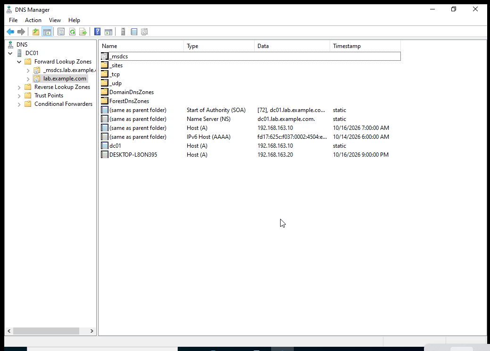
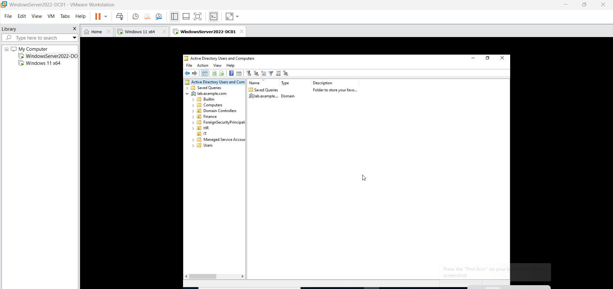

# Domain Controller Installation Report

**Windows Server 2022: Active Directory Domain Services and DNS**

| | |
|---|---|
| **Project** | Windows Server 2022 Active Directory & Group Policy Lab |
| **Platform** | VMware Workstation Pro |
| **Server** | `DC01` (Windows Server 2022 Standard Evaluation) |
| **Domain / forest** | `lab.example.com` (NetBIOS `LAB`) |
| **Domain controller IP** | `192.168.163.10/24` |
| **Result** | `DC01` promoted to the first domain controller of a new forest; DNS and DC discovery verified |

> Prefer automation? Steps 1 to 5 can be done with [`00-Set-StaticIP.ps1`](../scripts/00-Set-StaticIP.ps1) and [`01-Install-ADDS.ps1`](../scripts/01-Install-ADDS.ps1). The GUI steps below show what those scripts do.

## Contents

1. [Objective](#1-objective)
2. [Key concepts](#2-key-concepts)
3. [Lab environment](#3-lab-environment)
4. [Pre-installation checklist](#4-pre-installation-checklist)
5. [Installation procedure](#5-installation-procedure)
6. [Verification and testing](#6-verification-and-testing)
7. [Troubleshooting](#7-troubleshooting)
8. [Post-installation configuration](#8-post-installation-configuration)
9. [Evidence](#9-evidence)
10. [Conclusion](#10-conclusion)

## 1. Objective

Install Active Directory Domain Services (AD DS) on Windows Server 2022, promote the server to a domain controller (DC), create a new forest, and verify that DNS and DC discovery work. This is the foundation for the rest of the lab: OUs, users, groups, the domain-joined Windows 11 client and Group Policy.

## 2. Key concepts

| Term | Meaning |
|---|---|
| **AD DS** | The directory service that stores users, groups, computers and policies, and authenticates them. |
| **Domain controller** | A server that runs AD DS and answers authentication and directory requests for the domain. |
| **Forest / domain** | A forest is the top-level security boundary; a domain is a unit inside it. This lab has one forest with one domain. |
| **DNS** | AD depends on DNS. Clients find domain controllers through SRV records such as `_ldap._tcp`. |
| **Global Catalog (GC)** | A searchable index of objects in the forest. The first DC is always a GC. |
| **DSRM** | Directory Services Restore Mode: a recovery boot mode with its own password, separate from the domain administrator password. |
| **SYSVOL / NETLOGON** | Shared folders on every DC that distribute Group Policy files and logon scripts. |

> **Installing the role is not the same as promoting the server.** Adding the AD DS role only copies the binaries. The server becomes a domain controller only after the promotion wizard (or `Install-ADDSForest`) runs. This is a common interview question.

## 3. Lab environment

| Component | Configuration |
|---|---|
| Virtualization | VMware Workstation Pro |
| Operating system | Windows Server 2022 |
| Server name | `DC01` |
| IP address | `192.168.163.10` |
| Subnet mask | `255.255.255.0` |
| Default gateway | None (isolated host-only network) |
| Preferred DNS | `192.168.163.10` (the server itself) |
| Network adapter | VMnet1 (host-only) |
| AD domain / forest | `lab.example.com` |
| Forest and domain functional level | Windows Server 2016 |
| Installed roles | AD DS, DNS Server |

## 4. Pre-installation checklist

Complete these **before** promotion. Most promotion failures trace back to one of them.

- [ ] Static IP address configured (a DC must not use DHCP)
- [ ] DNS server on the DC's own adapter points to itself
- [ ] Server renamed to `DC01` (renaming after promotion is possible but harder)
- [ ] Only the intended network adapter is enabled (extra adapters register extra DNS records; see [DNS troubleshooting](dns-troubleshooting.md))
- [ ] Local `Administrator` account has a strong password (the prerequisite check expects it)
- [ ] Date, time and time zone are correct (Kerberos rejects clocks more than 5 minutes out of sync)
- [ ] Windows is activated or running in its evaluation period

## 5. Installation procedure

### Step 1: Configure a static IP address

1. Open **Server Manager → Local Server** and click the Ethernet adapter.
2. Right-click the host-only adapter → **Properties**.
3. Select **Internet Protocol Version 4 (TCP/IPv4)** → **Properties**.
4. Enter:

   ```text
   IP address:       192.168.163.10
   Subnet mask:      255.255.255.0
   Default gateway:  (blank)
   Preferred DNS:    192.168.163.10
   ```

A static IP lets clients always find the DC. A gateway is not needed because everything is on one isolated subnet.

PowerShell equivalent:

```powershell
.\scripts\00-Set-StaticIP.ps1 -InterfaceAlias "Ethernet0" -IPAddress 192.168.163.10 -DnsServer 192.168.163.10
```

### Step 2: Rename the server

1. **Server Manager → Local Server** → click the computer name → **Change**.
2. Enter `DC01`, click **OK** and restart.

```powershell
Rename-Computer -NewName DC01 -Restart
```

Verify after the restart:

```cmd
hostname
```

Expected output: `DC01`

### Step 3: Install the AD DS role

1. **Server Manager → Manage → Add Roles and Features**.
2. Choose **Role-based or feature-based installation** and select the local server `DC01`.
3. On **Server Roles**, check **Active Directory Domain Services** and click **Add Features**.
4. Continue through the wizard and click **Install**.

```powershell
Install-WindowsFeature -Name AD-Domain-Services -IncludeManagementTools
```

At this point the server is **not** yet a domain controller.

### Step 4: Promote the server to a domain controller

1. In Server Manager, click the notification flag → **Promote this server to a domain controller**.
2. Select **Add a new forest** (this is the first DC of a new environment).
3. Enter the root domain name `lab.example.com` and click **Next**.

### Step 5: Configure domain controller options

- Set the forest and domain functional levels to **Windows Server 2016**, the highest level Windows Server 2022 offers.
- Keep **Domain Name System (DNS) server** and **Global Catalog (GC)** checked.
- Enter and confirm a strong **DSRM password**. Store it somewhere safe and **never commit it to GitHub**.

### Step 6: Finish the wizard

1. **DNS Options:** a delegation warning is expected in an isolated lab, because no parent zone exists. Continue.
2. **Additional Options:** accept the NetBIOS name (`LAB`).
3. **Paths:** keep the default locations for the database, logs and SYSVOL.
4. **Review Options:** optionally click **View script** to see the equivalent PowerShell.
5. **Prerequisites Check:** resolve any blocking errors; warnings about delegation and Windows NT 4.0 cryptography are normal.
6. Click **Install**. The server restarts automatically.

Complete PowerShell equivalent of Steps 3 to 6 (prompts for the DSRM password):

```powershell
.\scripts\01-Install-ADDS.ps1
```

### Step 7: Sign in to the domain controller

After the restart, sign in with the domain administrator account:

```text
LAB\Administrator
```

or

```text
Administrator@lab.example.com
```

The local Administrator account no longer exists on a DC; the original password becomes the domain `Administrator` password.

## 6. Verification and testing

### Step 8: Verify Active Directory

Open **Server Manager → Tools → Active Directory Users and Computers** and expand `lab.example.com`:

```text
lab.example.com
├── Builtin
├── Computers
├── Domain Controllers      ← DC01 must be listed here
├── ForeignSecurityPrincipals
├── Managed Service Accounts
└── Users
```

### Step 9: Verify DNS

Open **Server Manager → Tools → DNS → DC01 → Forward Lookup Zones** and check:

```text
Forward Lookup Zones
├── _msdcs.lab.example.com
└── lab.example.com
```

| Record | Type | Value | Where |
|---|---|---|---|
| `dc01` | A | `192.168.163.10` | `lab.example.com` |
| `_ldap` | SRV | `dc01.lab.example.com`, port 389 | `_msdcs.lab.example.com → dc → _tcp` |

There must be **exactly one** A record for `dc01`. Extra addresses indicate an extra network adapter (see [troubleshooting](dns-troubleshooting.md)).

### Step 10: Verify domain controller health

Run in an elevated Command Prompt or PowerShell on `DC01`:

| Check | Command | Expected result |
|---|---|---|
| IP configuration | `ipconfig /all` | `192.168.163.10`, DNS `192.168.163.10` |
| Name resolution | `nslookup dc01.lab.example.com` | Returns `192.168.163.10` |
| DC discovery | `nltest /dsgetdc:lab.example.com /force` | Lists `DC01`, `lab.example.com`; "The command completed successfully" |
| DNS health | `dcdiag /test:dns /v` | All tests `passed` |
| Overall health | `dcdiag /q` | No output means no failures |
| Domain info | `Get-ADDomain` | `DNSRoot: lab.example.com`, `NetBIOSName: LAB` |
| Forest info | `Get-ADForest` | `ForestMode: Windows2016Forest` |
| DC info | `Get-ADDomainController` | Shows `DC01`, `IsGlobalCatalog: True` |
| Shared folders | `net share` | `NETLOGON` and `SYSVOL` are listed |
| Services | `Get-Service NTDS, DNS, Netlogon, Kdc` | All `Running` |

An automated PASS/FAIL version of the DNS and discovery checks is available as [`99-Test-Lab.ps1`](../scripts/99-Test-Lab.ps1).

## 7. Troubleshooting

| Symptom | Likely cause | Fix |
|---|---|---|
| Prerequisite check fails on the local administrator password | Local `Administrator` has a blank or weak password | Set a strong password, then re-run the check |
| DNS delegation warning | No parent zone for `lab.example.com` | Expected in an isolated lab; continue |
| `nslookup` shows `Server: Unknown` | No reverse lookup (PTR) record for the DNS server | Cosmetic; create a reverse zone if desired |
| DC has several A records | Multiple adapters registered their addresses | Disable the extra adapter, delete stale records, run `ipconfig /registerdns` ([details](dns-troubleshooting.md)) |
| SRV records missing | Netlogon did not register them | Run `nltest /dsregdns`, or restart the Netlogon service |
| Domain join fails with "domain could not be contacted" | Client DNS does not point to the DC | Set client DNS to `192.168.163.10` |
| Kerberos or logon errors | Clock skew over 5 minutes | Correct time and time zone on both machines |

## 8. Post-installation configuration

Completed after the domain controller was running:

| Task | Configuration |
|---|---|
| Organizational units | `IT`, `HR`, `Finance` |
| Domain users | Created inside department OUs |
| Security groups | `IT-staff`, `IT-ControlPanel-Restricted` |
| Client operating system | Windows 11 Pro |
| Client name / IP / DNS | `CLIENT01`, `192.168.163.20`, `192.168.163.10` |
| Domain join | `lab.example.com` |
| Group Policy | `IT-Block-ControlPanel` linked to the IT OU |
| Security filtering | Applied only to members of `IT-ControlPanel-Restricted` |

Continue with [Active Directory setup (client join)](active-directory-setup.md) and [Group Policy configuration](group-policy-configuration.md).

## 9. Evidence

| Verification | Screenshot |
|---|---|
| Server Manager, `DC01` in `lab.example.com` |  |
| Active Directory domain |  |
| DNS A and SRV records |  |
| Organizational units |  |

Worth adding: a screenshot of `nltest /dsgetdc:lab.example.com /force` and `dcdiag /test:dns /v` run on `DC01`, since the existing `nltest` evidence comes from the client.

## 10. Conclusion

Windows Server 2022 was installed in VMware, AD DS and DNS were installed, and `DC01` was promoted to the first domain controller of the `lab.example.com` forest. DNS records and DC discovery were verified with GUI tools and with `nslookup`, `nltest` and `dcdiag`. The same environment then supported OUs, users, security groups, a Windows 11 domain join and a security-filtered Group Policy.

The main takeaways: configure the static IP and DNS first, remember that installing the AD DS role and promoting the server are separate steps, and always verify DNS before building anything else on top of the domain.
