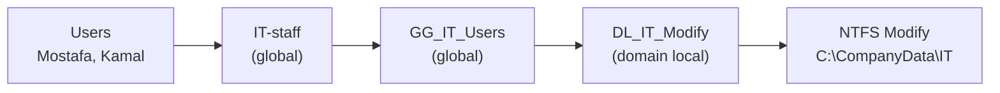

# File Server, AGDLP Groups and Shared Folder Permissions

**Department shares on Windows Server 2022 with NTFS permissions, access-based enumeration and a mapped network drive**

| | |
|---|---|
| **Server** | `DC01` (hosts the share in this lab) |
| **Client** | `CLIENT01` (Windows 11 Pro) |
| **Share** | `\\dc01.lab.example.com\CompanyData` → `C:\CompanyData` |
| **Folders** | `IT`, `HR`, `Finance` |
| **Permission model** | AGDLP (Accounts → Global → Domain Local → Permissions) |
| **Client drive** | `Z:` |
| **Result** | IT users can create and modify files in IT and cannot access HR |

> In this lab the share lives on the domain controller to keep the setup small. In production, use a separate member server as the file server: domain controllers should only run directory services.

## Contents

1. [Objective and real-world use](#1-objective-and-real-world-use)
2. [Design](#2-design)
3. [Lab environment](#3-lab-environment)
4. [Procedure](#4-procedure)
5. [Verification and test results](#5-verification-and-test-results)
6. [Evidence](#6-evidence)
7. [Security review](#7-security-review)
8. [Troubleshooting](#8-troubleshooting)
9. [Lessons learned](#9-lessons-learned)
10. [Conclusion](#10-conclusion)

## 1. Objective and real-world use

Give each department its own shared folder so that people can open only the data they need, and manage that access through groups instead of individual users.

In a real company, HR holds salary and personnel files, Finance holds invoices and IT holds scripts and licences. When someone joins the Finance team, the administrator adds their account to one group and they receive the Finance drive. When they leave, removing that one membership removes all of their access. The same group structure also gives auditors a clear answer to "who can access what".

## 2. Design

### 2.1 AGDLP

| Letter | Meaning | In this lab |
|---|---|---|
| **A** | Accounts | Users such as `Mostafa` and `Kamal` |
| **G** | Global groups | `IT-staff`, `GG_IT_Users`, one `GG_<Dept>_Users` per department |
| **DL** | Domain Local groups | `DL_IT_Modify`, one `DL_<Dept>_Modify` per department |
| **P** | Permissions | NTFS **Modify** on the matching department folder |

Verified membership chain for IT (see the [evidence](#6-evidence)):



HR and Finance follow the same naming pattern (`GG_HR_Users` → `DL_HR_Modify`, `GG_Finance_Users` → `DL_Finance_Modify`).

**Why this structure?** Permissions are placed on the domain local group once and never change. Day-to-day changes happen by adding or removing users in the global groups. Nothing is ever assigned to a single user.

### 2.2 Two permission layers

| Layer | Purpose | Setting used |
|---|---|---|
| **Share permissions** | Who may connect to the share at all | Broad (for example Authenticated Users), so they do not get in the way |
| **NTFS permissions** | Who may do what inside each folder | Restrictive, per department, via the DL groups |

When both apply, the **stricter** result wins, so keeping the share layer broad and managing everything in NTFS keeps troubleshooting simple.

### 2.3 Access-based enumeration (ABE)

With ABE on, a user browsing the share sees only the folders they have permission to open. Without it, people see every folder name (such as `HR`) and just get "Access denied" when they click it, which already leaks information.

## 3. Lab environment

| Component | Configuration |
|---|---|
| Server | `DC01`, Windows Server 2022, `192.168.163.10` |
| Client | `CLIENT01`, Windows 11 Pro, `192.168.163.20` |
| Domain | `lab.example.com` (NetBIOS `LAB`) |
| Local path | `C:\CompanyData` |
| Share name | `CompanyData` |
| Department folders | `C:\CompanyData\IT`, `\HR`, `\Finance` |
| OUs holding the groups | `IT`, `HR`, `Finance` |

## 4. Procedure

The same steps can be run with [`05-New-FileServer.ps1`](../scripts/05-New-FileServer.ps1). The GUI path and the equivalent PowerShell are shown for each step.

### Step 1: Verify connectivity between DC01 and CLIENT01

```cmd
ping 192.168.163.10
nslookup dc01.lab.example.com 192.168.163.10
```

```powershell
Test-NetConnection dc01.lab.example.com -Port 445   # SMB must be reachable
```

### Step 2: Check the File Server role

Server Manager → **File and Storage Services**, or:

```powershell
Get-WindowsFeature FS-FileServer
Install-WindowsFeature FS-FileServer     # only if it is not installed
```

### Step 3: Create the groups

In **Active Directory Users and Computers**, create in each department OU:

- one **Global** security group: `GG_IT_Users`, `GG_HR_Users`, `GG_Finance_Users`
- one **Domain Local** security group: `DL_IT_Modify`, `DL_HR_Modify`, `DL_Finance_Modify`

```powershell
New-ADGroup -Name GG_IT_Users  -GroupScope Global      -Path "OU=IT,DC=lab,DC=example,DC=com"
New-ADGroup -Name DL_IT_Modify -GroupScope DomainLocal -Path "OU=IT,DC=lab,DC=example,DC=com"
```

### Step 4: Build the AGDLP membership

```powershell
Add-ADGroupMember -Identity IT-staff     -Members Mostafa, Kamal   # accounts into the department group
Add-ADGroupMember -Identity GG_IT_Users  -Members IT-staff         # global into global
Add-ADGroupMember -Identity DL_IT_Modify -Members GG_IT_Users      # global into domain local
```

Repeat for HR and Finance with their own groups.

### Step 5: Create the department folders

```powershell
'IT','HR','Finance' | ForEach-Object { New-Item "C:\CompanyData\$_" -ItemType Directory -Force }
```

### Step 6: Configure NTFS permissions

For **each department folder**: Properties → **Security** → **Advanced** → **Disable inheritance** (convert, then remove unwanted entries such as `Users`) → **Add** the matching `DL_<Dept>_Modify` group with **Modify**. Keep `SYSTEM` and `Administrators` at Full control.

```powershell
icacls C:\CompanyData\IT /inheritance:r
icacls C:\CompanyData\IT /grant "*S-1-5-18:(OI)(CI)F" "*S-1-5-32-544:(OI)(CI)F" "LAB\DL_IT_Modify:(OI)(CI)M"
```

Apply the same to the share root so the department folders are not readable by every user (see [Security review](#7-security-review)).

### Step 7: Create the SMB share and enable ABE

Folder Properties → **Sharing** → **Advanced Sharing** → tick **Share this folder**, name it `CompanyData`, and set permissions. Enable access-based enumeration in **Server Manager → File and Storage Services → Shares → CompanyData → Properties → Settings → Enable access-based enumeration**.

```powershell
New-SmbShare -Name CompanyData -Path C:\CompanyData -FolderEnumerationMode AccessBased `
    -ChangeAccess 'Authenticated Users' -FullAccess 'BUILTIN\Administrators'
```

### Step 8: Map the drive on CLIENT01

```cmd
net use Z: \\dc01.lab.example.com\CompanyData /persistent:yes
```

In a larger environment, map drives with **Group Policy Preferences → Drive Maps** and item-level targeting by security group, so each user gets the right drive automatically.

## 5. Verification and test results

| Check | Result |
|---|---|
| DC01 and CLIENT01 network connectivity | Verified |
| File Server role | Checked |
| Three global security groups | Created |
| Three domain local security groups | Created |
| AGDLP membership | Configured |
| Department folders | Created |
| NTFS Modify permissions | Configured |
| `CompanyData` SMB share | Created |
| Access-based enumeration | Enabled |
| IT user creates and modifies files in IT | Works |
| IT user opens HR | Blocked |
| `Z:` network drive | Mapped |

Commands to re-run the checks:

| Check | Command (run where) |
|---|---|
| Group scopes | `Get-ADGroup -Filter "Name -like 'GG_*' -or Name -like 'DL_*'" \| ft Name, GroupScope` (DC01) |
| Nested membership | `Get-ADGroupMember DL_IT_Modify; Get-ADGroupMember GG_IT_Users` (DC01) |
| Folder permissions | `icacls C:\CompanyData\IT` (DC01) |
| Share and ABE setting | `Get-SmbShare CompanyData \| fl Name, Path, FolderEnumerationMode` (DC01) |
| Share permissions | `Get-SmbShareAccess CompanyData` (DC01) |
| User's effective groups | `whoami /groups` (CLIENT01, after a new sign-in) |
| Mapped drives | `net use` (CLIENT01) |
| Allowed access | `dir \\dc01.lab.example.com\CompanyData\IT` (CLIENT01) |
| Blocked access | `dir \\dc01.lab.example.com\CompanyData\HR` → `Access is denied.` (CLIENT01) |

Test as a member of each department. Group changes only take effect after the user signs out and back in.

## 6. Evidence

| Verification | Screenshot |
|---|---|
| Department and AGDLP groups in the IT OU |  |
| Membership chain: `IT-staff` → `GG_IT_Users` → `DL_IT_Modify` |  |
| `CompanyData` shared as `\\DC01\CompanyData` |  |
| NTFS advanced security settings on `C:\CompanyData` |  |
| Attempt to open the HR folder from CLIENT01 |  |
| `Z:` drive mapped to the share, showing only the `HR` folder |  |

## 7. Security review

**Root folder inheritance.** The NTFS screenshot shows `C:\CompanyData` still inheriting from `C:\`, so `BUILTIN\Users` has **Read & execute** (this folder, subfolders and files) and a special entry that lets users create folders. Any subfolder that keeps inheriting those entries would be readable by every domain user. This is why each department folder must have inheritance **disabled** with only its own DL group, `SYSTEM` and `Administrators` listed.

Recommended hardening for the root (also done by the script):

1. Disable inheritance on `C:\CompanyData` and remove `Users`.
2. Keep `SYSTEM` and `Administrators` at Full control.
3. Give `Authenticated Users` **Read & execute on "This folder only"**, so mapped drives open and ABE can list what each user may see.

**Other practices**

- Never grant a share or folder permission to an individual user.
- Do not put users straight into the DL groups; always go through the global groups.
- Keep domain controllers free of file shares in production.
- Document who owns each department group and review membership regularly.

## 8. Troubleshooting

| Symptom | Likely cause | Fix |
|---|---|---|
| User still cannot open their folder after being added to a group | Access token built at logon | Sign out and back in (or restart) |
| `Windows cannot access \\server\share\folder` with no clear reason | Generic message; can also mean a name or network problem | Expand **See details** for the error code, or run `dir \\server\share\folder` and look for `Access is denied` |
| User sees folders they should not | ABE off, or folder inherits `Users` from the parent | Enable ABE on the share; disable inheritance on the folder |
| DL group missing in the permission picker | Wrong location or object type | Set **Locations** to the domain and include **Groups** |
| Drive does not map | DNS, SMB blocked, or wrong path | `nslookup`, `Test-NetConnection -Port 445`, use the FQDN |
| Mapped drive shows an old view after a permission change | Cached connection | Disconnect with `net use Z: /delete` and map again after a new sign-in |
| Permissions look right but access still fails | Share layer stricter than NTFS | Check `Get-SmbShareAccess`; the stricter layer wins |

## 9. Lessons learned

1. Put permissions on groups, never on individual users.
2. Use AGDLP so that permissions are set once and people are managed in groups.
3. NTFS controls the real access; keep the share layer broad.
4. Access-based enumeration hides what users should not know exists.
5. Always test from the client with a real user and a fresh sign-in.
6. Check the folder you think is protected: inherited entries from a parent are the usual cause of unexpected access.

## 10. Conclusion

The lab now has a department file share built on AGDLP. Users are managed through global groups, permissions sit on domain local groups, NTFS enforces the access, and access-based enumeration shows each user only what they can use. The result was tested from `CLIENT01`: an IT user works in the IT folder, cannot access HR, and uses the share through a mapped `Z:` drive.

Next: map drives with Group Policy Preferences, add FSRM quotas and file screening, and enable Previous Versions (shadow copies). See [next steps](next-steps.md).
